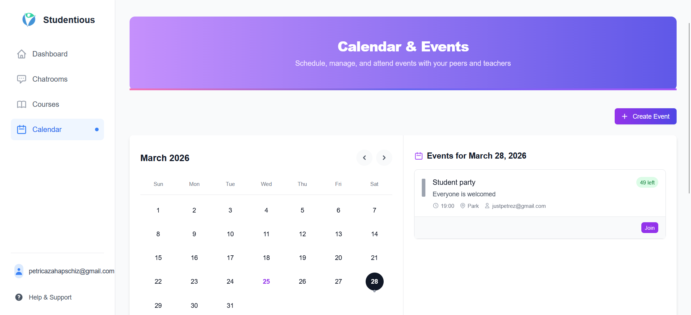
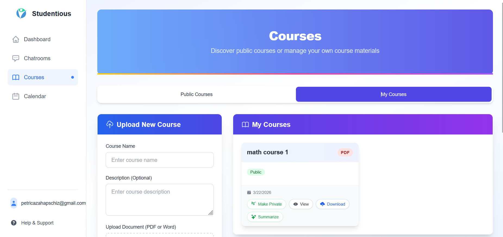
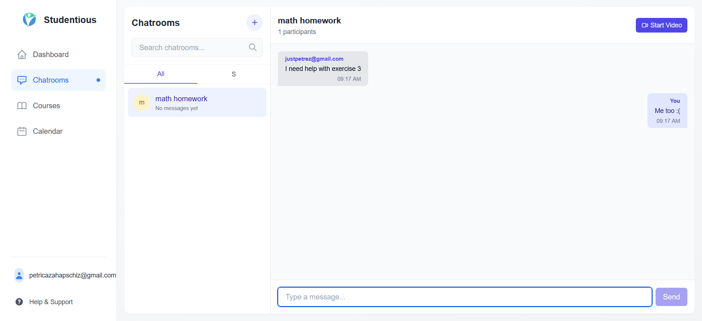
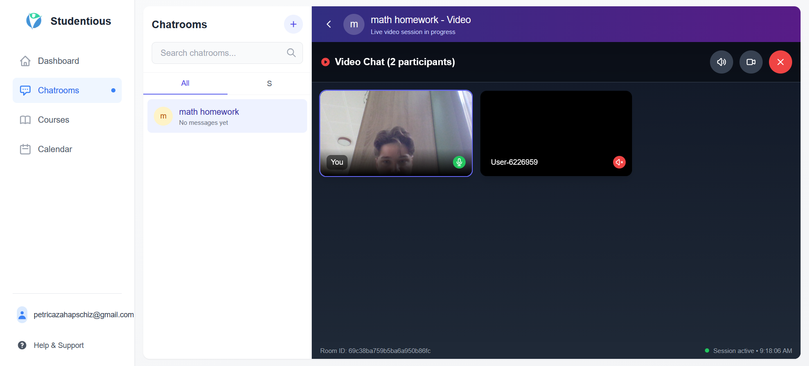

# 🧑‍🎓 Studentious - Next-Gen Educational Platform

 

  A comprehensive full-stack educational platform built with Next.js and MongoDB. Studentious goes beyond a traditional LMS by integrating AI-driven course summarization, text-to-speech functionality, and real-time video/text collaboration.

## 📱 Screenshots & Demo

  A visual tour of the Studentious platform, showing the dashboard, course materials, and collaboration features.

<table border="0">
  <tr>
    <td align="center" valign="top" colspan="2">
      <h3>📚 Platform Dashboard & Course Management</h3>
    </td>
  </tr>
  <tr>
    <td align="center">
      
       <em>Calendar & Events View</em>
    </td>
    <td align="center">
      
       <em>Course Material Management</em>
    </td>
  </tr>

  <tr>
    <td align="center" valign="top" colspan="2">
       <h3>🗣️ Real-Time Collaboration & Communication</h3>
    </td>
  </tr>
  <tr>
    <td align="center">
      
       <em>Live Community Chatrooms</em>
    </td>
    <td align="center">
      
       <em>Video Conferencing via Agora</em>
    </td>
  </tr>
</table>

## **🚀 Key Features**

* **Custom Authentication & Roles:** Cookie-based session management with distinct access levels for students and teachers.  
* **AI Content Pipeline:** Automatically generates summaries for uploaded course documents (PDF/Word) and translates them into multiple languages.  
* **Text-to-Speech (ElevenLabs):** Converts AI summaries into high-quality audio files for on-the-go listening.  
* **Real-Time Video & Chat:** Features community chatrooms powered by WebSockets/MongoDB and live video conferencing integrated via Agora.  
* **Smart Notifications:** Automated email notifications and recommendations handled by background cron jobs (node-cron).  
* **Performance Optimized:** Includes session caching and API endpoint protection (AuthGuard).

## **🛠️ Tech Stack**

* **Framework:** Next.js (Pages Router)  
* **Frontend:** React, Tailwind CSS  
* **Backend:** Node.js API Routes, custom useAuth() hook  
* **Database:** MongoDB (with Mongoose/clientPromise)  
* **Real-Time & Video:** Socket.IO (planned/alternative), Agora.io (Video Chat)  
* **AI & External APIs:** Google Generative AI (Summarization), ElevenLabs API (Audio), Translation API  
* **Other Tools:** pdf-lib (Document handling), node-cron (Schedulers)

## **⚙️ Getting Started**

Follow these steps to run the project locally.

### **1\. Clone the repository**

git clone \[https://github.com/PetricaZPC/studentious.git\](https://github.com/PetricaZPC/studentious.git)  
cd studentious

### **2\. Install dependencies**

npm install

### **3\. Set up Environment Variables**

Create a .env.local file in the root of the project and add the necessary API keys and database URIs:  
\# Database  
MONGODB\_URI=your\_mongodb\_connection\_string

\# Authentication & Sessions  
JWT\_SECRET=your\_jwt\_secret\_key

\# External APIs  
ELEVENLABS\_API\_KEY=your\_elevenlabs\_key  
AGORA\_APP\_ID=your\_agora\_app\_id  
AGORA\_APP\_CERTIFICATE=your\_agora\_certificate  
GEMINI\_AI\_API\_KEY=your\_gemini\_key (summaries, translation; the assistant also accepts GEMINI\_API\_KEY)

Optional: `GEMINI_MODEL` (default `gemini-2.5-flash`), `ELEVENLABS_MODEL_ID` (default `eleven_multilingual_v2`), `MONGODB_DB_NAME` (default `studentious`).

### **4\. Run the development server**

npm run dev

Open [http://localhost:3000](https://www.google.com/search?q=http://localhost:3000) with your browser to see the result.

## **🎮 Demo mode**

The login page has a **Try application** button that opens the app immediately: no account, no sign-up and **no database**.
Sample data (two public courses, a private sample course with a ready-made summary, three upcoming events and two chat rooms)
is stored in the visitor's own browser (`localStorage`), and `src/utils/demoClient.js` answers the `/api/*` calls (fetch and
axios) from it while demo mode is on. Nothing is sent to or saved on the server. Logging out, or clearing the site data,
removes the demo. Normal sign-in and sign-up are unchanged and still use MongoDB. The sample PDFs live in `public/demo/`.
In the demo, the teacher password asked on the account page is `1234` (the same one the app checks).

Known limitations of the demo:

- Summaries of new uploads, translation, the AI assistant and audio are unavailable or show static text: the real features use
  **free API keys (Google Gemini, ElevenLabs) that have most likely expired or hit their quota**. The sample courses already
  include summaries.
- Video chat needs live Agora credentials and does not work in the demo.
- Other visitors never see your events, messages or courses.
